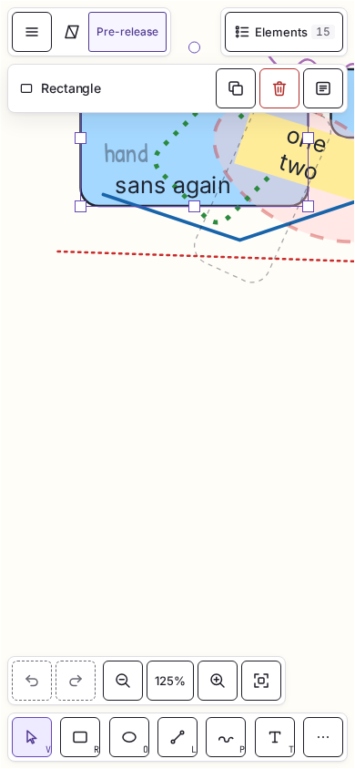

# Planewright

An independently engineered open-source infinite canvas for drawing and diagrams.


Planewright is a browser editor in its foundation phase, and no version of it has been released
yet. Its canvas fills the window, pans and zooms, and has its controls floating over it. Today it
can:

- draw rectangles, ellipses, diamonds, lines, freehand strokes and texts, then select, move,
  resize, rotate, duplicate, delete and nudge them, edit texts again, and undo and redo each change;
- show the selection's kind or count, position, size and angle in a panel, or a bar on phones;
- list the elements in a drawer, a sheet on phones, through which the keyboard alone reaches each
  of them, announce every change to screen readers and list every keyboard shortcut in a dialog;
- save the drawing in the browser's IndexedDB storage and restore it on reload, showing a "Not
  saved" chip only when the drawing cannot be saved;
- fit phones: in portrait the tools sit in a dock at the bottom, every target is at least 44 px and
  the controls keep clear of the screen's safe areas.

It has no text formatting, no style controls, no arrows, notes or images, no files to open, save or
export, and no collaboration, since the collaboration service is only a skeleton. Every performance
budget is measured, and CI gates only the bundle sizes so far; the redraw of 5,000 elements in view
misses its budget in some CI runs, which issue #49 follows.

<p align="center">
  
</p>

Both screenshots are
[visual-regression baselines](docs/architecture/editor-experience.md#what-s13-delivered) that CI's
Linux Chromium made from the end-to-end tests' seeded drawing and compares on every run: V09, with
the Elements drawer open, and V19, with a rectangle selected on a phone. The drawing's colours,
strokes and fonts come from that fixture, since the editor has no style controls yet.

## Goals

- A fast, accessible infinite canvas for sketching, diagrams and whiteboarding in the browser.
- Real-time collaboration through a self-hostable, autonomous Node.js WebSocket service.
- A codebase that stays small, strictly typed, well-tested and easy to review.

## How the project is built

Planewright follows an **investigate-then-implement** workflow:

1. **Behavioural investigation.** Before a feature is designed, its expected behaviour is
   investigated and documented in an investigation issue and under
   [`docs/investigation/`](docs/investigation/README.md).
2. **Issue-driven delivery.** Each feature, fix or change is tracked by a GitHub issue,
   implemented on a branch named `<type>/<issue>-<kebab-summary>` and merged through a reviewed
   pull request that passes CI.
3. **Independent implementation.** Planewright's code, assets and design are its own.

### Independence and references

Planewright is an independent project. It is **not affiliated with, endorsed by or derived
from** Excalidraw or REA.

- **Excalidraw** is used only as a _behavioural reference_: observable behaviour of the public
  application may inform what users expect. Planewright does not use the `@excalidraw/*`
  packages and does not copy Excalidraw source code, assets, fonts or icons. CI enforces the
  dependency part of this rule.
- **REA (Reverse Engineer Anything)**, an MIT-licensed analysis toolkit, is used only as
  _methodology and tooling_ for structured behavioural investigation.

The full policy is in
[ADR 0003: clean-room reference policy](docs/adr/0003-clean-room-reference-policy.md).
Product names are used only to identify these references.

## Repository layout

| Path                                               | Contents                                                                                       |
| -------------------------------------------------- | ---------------------------------------------------------------------------------------------- |
| [`apps/web`](apps/web)                             | React + Vite browser application: a pre-release editor surface                                 |
| [`apps/collab`](apps/collab)                       | Node.js WebSocket collaboration service (health endpoint + hello only)                         |
| [`packages/protocol`](packages/protocol)           | Runtime-agnostic wire protocol definitions shared by clients and services                      |
| [`packages/engine`](packages/engine)               | ECMAScript-only canvas engine, from math to the editor façade                                  |
| [`packages/render-canvas`](packages/render-canvas) | Canvas 2D renderer of the engine's render frames, on the page's canvas                         |
| [`scripts`](scripts)                               | Guardrails, bundle-size check, performance report and branch-name rule                         |
| [`docs`](docs/README.md)                           | Architecture decisions, investigation process, development guides and the README's screenshots |
| [`.github`](.github)                               | CI, CodeQL, Dependabot, issue forms and the pull request template                              |

## Requirements

- **Node.js 24.22.1** (see [`.nvmrc`](.nvmrc))
- **npm 11.19.1**, the version bundled with Node.js 24.22.1

Both versions are pinned exactly and enforced by `engines`, `devEngines` and
`engine-strict=true`, so installs fail fast on a different toolchain.

## Getting started

```sh
git clone https://github.com/mariechristsagbo/planewright.git
cd planewright
nvm use            # or install Node.js 24.22.1 another way
npm ci
npm run dev:web    # http://localhost:5173
```

To run the collaboration service skeleton:

```sh
cp .env.example .env   # optional; defaults are used when unset
npm run dev:collab     # http://127.0.0.1:8787/healthz, WebSocket at ws://127.0.0.1:8787/ws
```

## Quality gates

| Command                                                             | What it checks                                                                 |
| ------------------------------------------------------------------- | ------------------------------------------------------------------------------ |
| `npm run format:check`                                              | Prettier formatting                                                            |
| `npm run lint`                                                      | ESLint with type-aware rules and complexity guardrails                         |
| `npm run typecheck`                                                 | Strict TypeScript across every workspace                                       |
| `npm run test:unit`                                                 | Unit tests (Vitest)                                                            |
| `npm run test:integration`                                          | Integration tests, including the real WebSocket service                        |
| `npm run test:coverage`                                             | All Vitest projects with coverage thresholds                                   |
| `npm run test:e2e`                                                  | Playwright tests against the production build (needs Chromium)                 |
| `npm run build`                                                     | Production builds of the web app and collaboration service                     |
| `npm run guardrails`                                                | File-size limits and the forbidden-dependency policy                           |
| `npm run check:bundle-size`                                         | Bundle sizes of the engine, the renderer and the web app against their budgets |
| `npm run perf:bench`, `npm run perf:browser`, `npm run perf:report` | The performance budgets: benchmarks, browser measurements and their report     |
| `npm run secrets:scan`                                              | Secretlint scan of the working tree                                            |
| `npm run audit:deps`                                                | `npm audit` and registry signature verification                                |
| `npm run validate`                                                  | Every local gate except e2e and audit, in CI order                             |

See [docs/development/quality-gates.md](docs/development/quality-gates.md) for thresholds and
rationale.

## Contributing

Contributions are welcome once the foundation phase ends and feature issues are open. Read
[CONTRIBUTING.md](CONTRIBUTING.md) and the [Code of Conduct](CODE_OF_CONDUCT.md). Report
security issues privately as described in [SECURITY.md](SECURITY.md).

## License

[MIT](LICENSE) © 2026 Marie-Christ Sagbo
